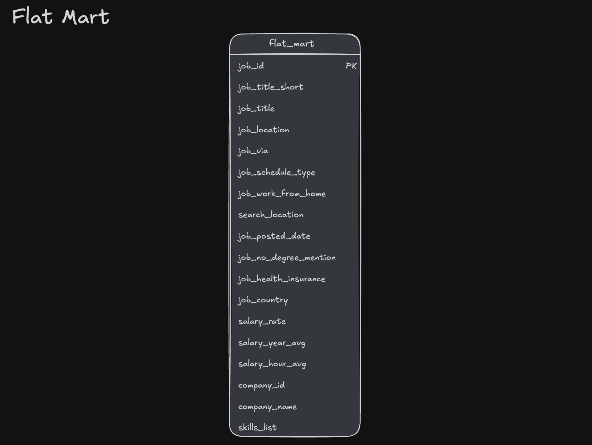
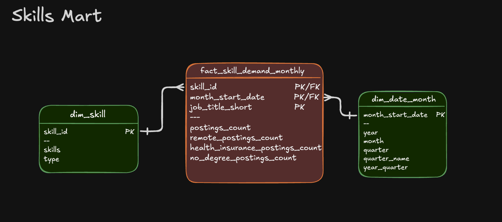

# 🏗️ Production ETL Pipeline: Data Warehouse & Analytical Marts
[](https://duckdb.org/)
[-blue.svg)](#)
[](https://cloud.google.com/storage)
[](#)

An end-to-end Data Engineering pipeline that ingests raw telemetry and job posting data from **Google Cloud Storage (GCS)**, transforms it into a normalized **Kimball Star Schema Data Warehouse**, and provisions specialized **Analytical Data Marts** optimized for low-latency BI queries and ad-hoc analytics.


---

## 🧾 Executive Summary (For Hiring Managers)

| Pillar | Engineering Highlights |
| :--- | :--- |
| **Data Architecture** | Designed an end-to-end ELT/ETL lifecycle transitioning data from raw cloud object storage (Bronze) to a centralized Star Schema (Silver) to downstream Data Marts (Gold). |
| **Dimensional Modeling** | Implemented Kimball methodology: Fact tables, Conformed Dimensions, and Bridge tables to resolve complex Many-to-Many ($M:N$) relationships. |
| **ETL & Orchestration** | Engineered an automated, idempotent orchestration pipeline using DuckDB with native `httpfs` remote GCS scanning. Built incremental update pipelines leveraging SQL `MERGE` (Upsert pattern). |
| **Performance & Analytics** | Designed aggregate data marts with purely **additive measures** to guarantee metric consistency across cross-dimensional rollups in BI layers (Power BI, Tableau, Excel). |

---

## 🎯 Business Context & Engineering Challenges

### The Problem
Raw job posting datasets land in **Google Cloud Storage** as flat CSVs. Running analytical workloads directly against these raw files creates major bottlenecks:
1. **Compute Inefficiency:** Scanning large flat files for repetitive aggregations causes high computational latency and memory bloat.
2. **Metric Inconsistency:** Redundant and unnormalized data leads to discrepancies across cross-functional analytical queries.
3. **Complex Relationships:** Many-to-Many entities (e.g., job postings linked to multiple dynamic skills and multi-hub company locations) cannot be cleanly analyzed without dimensional normalization.

### The Solution
A high-performance SQL data warehouse leveraging **DuckDB** to execute cloud-connected analytical queries with zero-copy efficiency. The pipeline cleanses raw data into a normalized **Single Source of Truth (SSOT)** and exposes pre-aggregated, granular **Data Marts** tailored to specific business workloads.

---

## 🛠️ Tech Stack & Tooling

| Category | Technology | Usage in Project |
| :--- | :--- | :--- |
| **Database / OLAP Engine** | **DuckDB** | Columnar vectorised engine for ultra-fast in-process ELT processing. |
| **Cloud Storage** | **Google Cloud Storage (GCS)** | Data Lake layer hosting raw CSV extracts (`httpfs` integration). |
| **Transformation Language** | **Advanced SQL** | DDL for schema migration, DML for transformations, CTEs, Windowing, and `MERGE`. |
| **Data Modeling** | **Kimball Star Schema** | Fact/Dimension separation, Bridge tables, Surrogate Keys. |
| **Pipeline Automation** | **Master SQL Script** | Scripted pipeline runner executing tasks in dependency order. |
| **Development** | **VS Code & CLI** | Local development, profiling, and DuckDB native CLI runs. |

---

## 🗂️ Repository Architecture

```text
2_WH_Mart_Build/
├── create_tables_dw.sql       # DDL: Builds normalized warehouse schemas & constraints
├── load_schema_dw.sql         # ELT: Extracts from GCS via HTTPFS & loads core warehouse
├── create_flat_mart.sql       # Mart 1: Denormalized flat model for rapid ad-hoc reporting
├── create_skills_mart.sql     # Mart 2: Time-series skill demand mart (additive metrics)
├── create_priority_mart.sql   # Mart 3: Snapshot mart tracking target/priority job posts
├── update_priority_mart.sql   # CDC: Production-grade MERGE (Upsert/Delete) pipeline
├── create_company_mart.sql    # Mart 4: M:N bridge-enabled company hiring trend mart
├── build_dw_marts.sql         # Orchestration: Master build script running the complete pipeline
└── README.md                  # Technical documentation
```

---

## 🏛️ Data Warehouse & Marts Architecture


The pipeline transforms job posting CSVs from Google Cloud Storage into a normalized star schema data warehouse, then builds specialized analytical data marts. BI tools (Excel, Power BI, Tableau, Python) consume from both the warehouse and marts.

### 1. The Core Warehouse (Silver Layer)

A normalized star schema serving as the organization's Single Source of Truth (SSOT).


- job_postings_fact (Grain: One row per job posting).
- company_dim & skills_dim (Conformed attributes).
- skills_job_dim (Associative bridge table resolving M:N relationships between postings and technical competencies).
- Source Scripts: create_tables_dw.sql, load_schema_dw.sql.

### 2. Downstream Analytical Marts (Gold Layer)

**⚡ Flat Mart — Self-Service Analytics**



- **File:** [`create_flat_mart.sql`](./create_flat_mart.sql)
- **Target Workload:** Self-serve ad-hoc querying and quick business discovery without complex JOINs.
- **Grain:** 1 row per job posting with enriched company and location attributes.

### 📈 Skills Mart — Time-Series Trend Analysis

Time-series skill demand analysis with additive measures.



- **File:** [`create_skills_mart.sql`](./create_skills_mart.sql) – Builds time-series skill demand mart
- **Target Workload:** Tracking technology popularity shifts across months and disciplines.
- **Grain:** `skill_id + month_start_date + job_title_short`
- **Architectural Standard:** Contains **strictly additive measures** (e.g., posting counts, aggregate sums), avoiding non-additive pre-averaged metrics to guarantee cross-dimensional safety when slicing.

### 🔄 Priority Mart — Change Data Capture & Upsert Workflow

Priority role tracking with incremental updates using MERGE operations.


- **Files:**
  - [`create_priority_mart.sql`](./create_priority_mart.sql) – Initial build of priority roles and jobs snapshot
  - [`update_priority_mart.sql`](./update_priority_mart.sql) – **Incremental update using MERGE** (upsert pattern)
- **Target Workload:** High-priority recruitment tracking requiring continuous status synchronizations.
- **Grain:** One row per job posting with priority level assignment
- **Key implementation:** **MERGE operations for incremental updates.** Employs SQL `MERGE` operations (`WHEN MATCHED`, `WHEN NOT MATCHED INSERT`, `WHEN NOT MATCHED BY SOURCE DELETE`) to mimic real-world batch-driven CDC pipeline updates.

### 🏢 Company Mart — Hierarchical & Multi-Entity Slicing

Company hiring trends by role, location, and month.


- **File:** [`create_company_mart.sql`](./create_company_mart.sql) – Builds company hiring trends mart (optional)
- **Target Workload:** Enterprise recruitment analytics by location, company tier, and specialization.
- **Grain:** `company_id + job_title_short_id + location_id + month_start_date`
- **Modeling design:** Implements explicit bridge tables (`bridge_company_location`) to handle multi-hub companies without creating synthetic Cartesian product duplication.
- **Note:** This mart is optional and can be skipped if not needed

---

## 🧠 Core Engineering Principles Applied

### 1. Kimball Dimensional Modeling

- **Fact & Dimension Segregation**: Separated numerical measurements (job_postings_fact) from descriptive context (company_dim, skills_dim).
- **Bridge Tables for M : N Relations**: Prevented data duplication and fan-out errors when linking multi-skill jobs and multi-location companies.
- **Measure Additivity**: : Built aggregate marts using strictly additive metrics (sums, counts) to ensure valid multi-dimensional rollups in reporting layers.

### 2. Pipeline Idempotency & Data Quality

- **Deterministic Pipeline Execution**: Every script uses safe drop-and-recreate patterns (DROP TABLE IF EXISTS, atomic schemas) to guarantee zero side-effects upon re-running.
- **Explicit Schema Enforcement**: Cast raw CSV string payloads into strict types (TIMESTAMP, DOUBLE, INTEGER, BOOLEAN) to safeguard against silent schema drift.
- **Logical Schema Isolation**: Segregated marts into dedicated schemas (flat_mart, skills_mart, priority_mart, company_mart) for granular security and governance.

### 3. Advanced Analytical SQL

- **Declarative Upserts (MERGE INTO)**:  Replaced brute-force truncate-and-loads with surgical inserts, updates, and deletes in a single atomic transaction.
- **Window Functions & Surrogate Keys**: Generated deterministic surrogate keys via CTEs and ranking window functions.
- **Metric Normalization**: Transformed categorical string flags (e.g., remote status, degree requirements) into uniform boolean indicators via CASE WHEN logic.

## 🚀 How to Run the Pipeline

### Prerequisites

- [DuckDB CLI](https://duckdb.org/install/?platform=macos&environment=cli) installed locally.
- Internet access (to allow DuckDB's httpfs extension to read from Cloud Storage).

### Execution Steps

**1. Clone the repository:**
```bash
git clone https://github.com/<your-username>/data-warehouse-etl-duckdb.git
cd data-warehouse-etl-duckdb/2_WH_Mart_Build
```

**2. Run the Master Orchestration Script:**
You can run the entire pipeline end-to-end directly using DuckDB CLI:
```bash
duckdb analytics_dw.duckdb -f build_dw_marts.sql
```

**Option A: Exécution locale**
```bash
duckdb dw_marts.duckdb -c ".read build_dw_marts.sql"
```
**Option B: Déploiement Cloud Serverless (MotherDuck)**

```bash
export MOTHERDUCK_TOKEN="ton_token_ici"
duckdb "md:dw_marts" -c ".read build_dw_marts.sql"
```


**Verify the Results:**
Open the DuckDB database and inspect generated marts:

-- Launch interactive CLI

```bash
duckdb analytics_dw.duckdb
```


-- Preview top skills from the aggregate mart
```bash
SELECT * FROM skills_mart.skill_demand_monthly
ORDER BY demand_count DESC LIMIT 10;
```

## 👨‍💻 Author
**Chouaib MOUID**
***Data Engineer***

📫 Contact & Liens
- LinkedIn : [MOUID / Chouaib](https://www.linkedin.com/in/chouaib-mouid-200893438/)
- GitHub : [Chouaib-mouid](https://github.com/chouaibmouidis-py)


